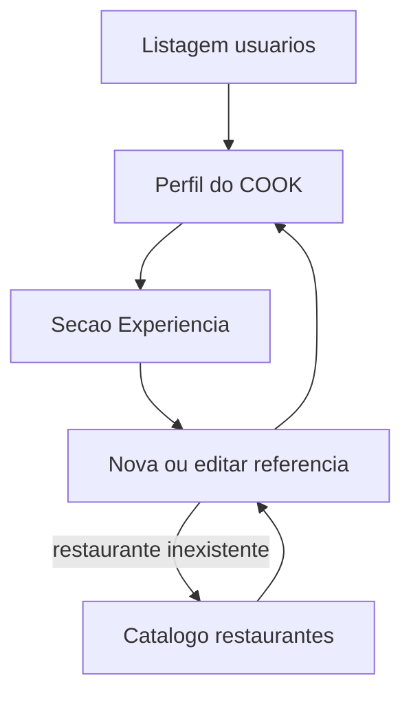

# Funcionalidade — Perfil COOK como contexto (experiência / referências)

**ID:** `FN-UI-COOK-PROFILE`  
**Status:** implementado na UI (hub no perfil COOK; leitura via filtro/`userId`; embed na API ainda evolutivo)  
**Domínio API relacionado:** [RN — Referência de emprego](../../api-recipes-collection/docs/versao-2/RN-referencia-emprego.md)

Este documento define **como a interface apresenta** o cozinheiro e seus vínculos. Regras de persistência, papel COOK, datas e visibilidade HTTP permanecem na API.

---

## Problema

Tratar **Restaurantes** e **Referências de emprego** como módulos irmãos de Categorias/Papéis sugere “dado de sistema”. Na prática, a referência é **histórico profissional do usuário COOK**; o restaurante é catálogo de apoio ao vínculo.

## Objetivo

O **perfil do usuário COOK** é o hub. Referências são lidas e mantidas no contexto desse usuário. Restaurantes continuam existindo como cadastro auxiliar, não como jornada principal.

---

## Escopo funcional (UI)

| Item | Incluído |
|------|----------|
| Perfil COOK com seção **Experiência profissional** | Sim |
| Listar referências embutidas no perfil (leitura centrada no usuário) | Sim |
| Criar/editar/remover referência a partir do perfil (`userId` implícito) | Sim |
| Atalho para cadastrar restaurante no meio do fluxo de referência | Sim |
| Catálogo admin de restaurantes (manutenção em lote) | Sim (secundário) |
| Menu raiz “Referências” como jornada principal | Não (remover ou rebaixar a atalho) |
| Seção Experiência para papéis ≠ COOK | Não |

---

## Fluxo adequado



### Passos

1. **Listagem de usuários** → abrir **Perfil**.
2. **Perfil (hub)** — seções:
   - Identidade (nome, CPF, papel, situação, ingresso)
   - Acesso (credenciais / criar login)
   - **Experiência profissional** (só se `roleName === 'COOK'`)
   - Ações (editar perfil, desativar)
3. **Experiência** — cada linha: restaurante (nome + cidade), período (`início — fim` ou `início — atual`), contato, editar/remover.
4. **Adicionar referência** (sub-rota ou drawer do perfil, ex. `/admin/usuarios/:id/referencias/nova`):
   - `userId` = id do perfil aberto (não selecionável)
   - escolher restaurante no catálogo
   - se não existir → cadastrar restaurante e voltar selecionado
   - datas + contato → salvar → voltar ao perfil com a seção atualizada

---

## Contrato de leitura desejado (API → UI)

A UI prefere **uma leitura de perfil** que já traga as referências. Sugestão de shape (contrato a evoluir na API; não duplica RN de escrita):

```json
{
  "id": 1,
  "name": "…",
  "roleName": "COOK",
  "references": [
    {
      "id": 10,
      "startsAt": "01/01/2023",
      "endsAt": null,
      "contactNumber": "61999999999",
      "restaurant": { "id": 2, "name": "Casa da Massa", "city": "São Paulo" }
    }
  ]
}
```

Alternativas aceitáveis enquanto o embed não existir:

- `GET /users/{id}/references`, ou
- `GET /references?userId={id}` (filtrado) + montagem na UI

Escrita continua em `POST/PUT/DELETE /references` conforme a API.

---

## Critérios de aceite (UI)

- [x] Admin abre o perfil de um COOK e vê referências sem ir a um menu “Referências” separado.
- [x] Criar referência a partir do perfil não pede seleção de cozinheiro.
- [x] Usuário não-COOK não vê a seção Experiência.
- [x] Restaurante pode ser criado como apoio no fluxo, sem ser a entrada principal da jornada.
- [ ] Documentação da API aponta para este arquivo como requisitos de apresentação (ver seção de referência cruzada abaixo).

---

## Referência cruzada (outro repositório)

| De | Para |
|----|------|
| Este doc | API — [RN-referencia-emprego.md](../../api-recipes-collection/docs/versao-2/RN-referencia-emprego.md) |
| API | Este arquivo — caminho estável: `../frontend-recipes-collection/docs/06-perfil-cook-contexto.md` |

Identificador estável para citar em PRs/issues da API: **`FN-UI-COOK-PROFILE`**.
